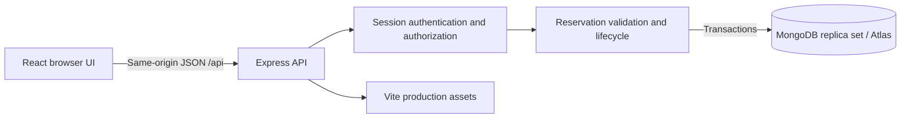

# CampusSlot

**Campus equipment, shared fairly.** An original MERN application by **Darshan** for reserving and managing shared campus equipment.

Source: https://github.com/darshannahata5555-cpu/campusslot-mern

Validation on 27 October 2026: production build and all three automated test groups passed, including real MongoDB replica-set integration. Browser visual verification could not be completed because the browser origin approval was denied. Public app deployment and demo video are still pending.

## Problem and target users

Students need cameras, microphones, projectors, and prototyping equipment for short projects. Informal messages and spreadsheets make availability uncertain, cause overlapping promises, and leave equipment returns untracked. CampusSlot serves student borrowers and equipment coordinators.

## Solution and major workflows

1. **Discover and plan:** search equipment, filter categories, inspect pickup locations and already reserved windows.
2. **Request a reservation:** choose a future time window and project purpose. Server validation enforces a seven-day duration, 90-day advance limit, three-active-reservation quota, and no overlaps. Pending requests hold their slot.
3. **Review and approve:** coordinators approve or reject requests. Students can cancel pending/approved requests; cancellation and rejection release the slot.
4. **Check out and return:** staff record physical handover during the approved window and record returns. An item still checked out cannot be handed to another borrower. Overdue loans are computed from return deadlines.
5. **Track accountability:** students see their own bookings and event history; staff see all bookings, filters, counts, and the audit trail.

## Stack and architecture

MongoDB (official driver), Express 5, React 19, Node.js 24; Vite for frontend builds. No SQLite, browser-only persistence, or mocked API is used.



Express serves the compiled React app and API from one origin. MongoDB stores users, hashed sessions, equipment, bookings, and activity. The UI does not decide authorization or final availability.

### Engineering decisions

- **Atomic reservations:** a MongoDB transaction writes the equipment document before reading conflicts. Concurrent requests for the same equipment cause a write conflict and transaction retry; the retry sees the winning reservation. A write to the user document also serializes per-user quota decisions across equipment.
- **Intervals:** half-open `[start, end)` windows allow a reservation to begin exactly when the previous one ends. Pending, approved, and checked-out bookings block overlapping windows.
- **Lifecycle:** `pending → approved → checked_out → returned`; pending requests may be rejected, and owners may cancel pending/approved requests. Invalid or duplicate actions fail instead of silently mutating state.
- **Security:** scrypt salted password hashes, random session cookies, hashed session tokens in MongoDB, session expiry, HttpOnly/SameSite cookies, Secure cookies in production, origin checks for browser mutations, Helmet headers, login throttling, server validation, unique email index, and ownership checks. Public availability exposes dates only.
- **Time:** MongoDB stores UTC dates; the browser displays local times. Overdue is derived rather than stored so it cannot become stale.
- **Deployment:** one Node service and Atlas keeps the frontend/API same-origin and avoids CORS/token-storage complexity.

## Local setup

### Quick local demonstration

With Node.js 24+, run `npm ci`, `npm run build`, then `npm run demo`. This downloads and starts a real loopback-only MongoDB replica set (no Docker or Atlas required), seeds demonstration users, and serves http://localhost:3000. Database files are retained in ignored `data/local-demo` between launches. First startup needs internet for the MongoDB binary. This convenience mode uses development dependencies and public demo passwords; use the Atlas configuration below for deployment.

Student: `student@campusslot.demo`; staff: `staff@campusslot.demo`; password: `CampusDemo123!`.

Requires Node.js **24+**, npm, and either MongoDB Atlas or a local MongoDB replica set. A standalone `mongod` will not support booking transactions.

```sh
npm ci
```

Copy `.env.example` to `.env` and set `MONGODB_URI`. Node does not load `.env` automatically in `npm start`; use the commands below or configure environment variables in your host.

### Option A: Atlas

Create an Atlas cluster, a database user with access to the application database, and a network access entry for your application host. Copy the driver's connection string into `.env`. URL-encode special characters in the password. Never commit this file.

### Option B: local MongoDB with Docker

```sh
docker compose up -d --wait
```

The included compose file initializes a single-node replica set and binds MongoDB to localhost. Use the example URI. This setup is for local development only, without database authentication; never expose its port publicly.

### Run

```sh
npm run build
node --env-file=.env server/index.js
```

Open **http://localhost:3000**. For frontend development, run the backend as above and `npx vite` in a second terminal; Vite proxies `/api` to port 3000. For backend reload, use `node --env-file=.env --watch server/index.js`.

### Student and coordinator accounts

Register student accounts in the app. Public registration can never create a staff account. Create a coordinator from a trusted terminal:

```powershell
$env:STAFF_PASSWORD = Read-Host 'New staff password (12+ characters)'
node --env-file=.env server/create-staff.js "Equipment Coordinator" "coordinator@example.com"
Remove-Item Env:STAFF_PASSWORD
```

For disposable local demo data only, set `SEED_DEMO=true` in `.env` before starting. This creates `student@campusslot.demo` and `staff@campusslot.demo`, both with password `CampusDemo123!`. These are public demonstration credentials. **Do not enable demo accounts on a real installation with private data.** Setting the flag back to false does not delete existing demo users; remove them from the database if converting the installation to real use.

## Environment variables

| Variable | Purpose | Default |
| --- | --- | --- |
| `MONGODB_URI` | Atlas/replica-set connection string; required secret | None |
| `MONGODB_DB` | Database name | `campusslot` |
| `PORT` | HTTP listening port | `3000` |
| `NODE_ENV` | Set `production` on HTTPS deployments for Secure cookies | Development |
| `SEED_DEMO` | Explicit opt-in to local demo accounts | `false` |
| `STAFF_PASSWORD` | Used only by staff creation script | None |

## Testing

```sh
npm test
npm run build
```

Integration tests start a real temporary single-node MongoDB replica set through `mongodb-memory-server`; the first run downloads a MongoDB binary and requires internet access. They do not use your configured Atlas database. Tests cover date constraints, role transitions, duplicate signup, invalid input, concurrent slot requests, ownership, premature checkout, complete checkout/return, duplicate return, adjacent slots, quota, cancellation release, privacy, CSRF origin rejection, and session revocation.

## Deployment

This repository contains `render.yaml` and a Dockerfile. A deployment has **not** been created merely by having these files.

[Deploy this repository to Render](https://render.com/deploy?repo=https://github.com/darshannahata5555-cpu/campusslot-mern). The blueprint selects a free web service and asks for the `MONGODB_URI` secret. Use an Atlas replica-set connection; do not use the local development URI on Render.

1. Push this source to your own GitHub repository.
2. Create an Atlas database and configure network access for the host.
3. On a Node-compatible host (the provided blueprint targets Render), create a service from this repository. Build: `MONGOMS_DISABLE_POSTINSTALL=1 npm ci --include=dev && npm run build`. Start: `npm start`. Health check: `/api/health`. Explicitly including development dependencies makes Vite available even with `NODE_ENV=production`; disabling the test database's install-time binary download avoids downloading an unused MongoDB server during deployment.
4. Set `MONGODB_URI` as a secret and `NODE_ENV=production`. Use HTTPS. The app expects one trusted reverse proxy; adjust Express `trust proxy` for a different topology.
5. Create a staff account using the script with the same database connection, then clear `STAFF_PASSWORD`.
6. Open the deployed URL, register a student, create/approve a request, check it out during its window, and return it. Test persistence by restarting the service.
7. Verify repository, app, and video links in a private browser window.

For Docker, build the supplied Dockerfile and supply the Atlas URI at runtime. The local compose database is not a production hosting configuration.

## API overview

| Method | Route | Access |
| --- | --- | --- |
| POST | `/api/register`, `/api/login`, `/api/logout` | Public/session |
| GET | `/api/me`, `/api/equipment`, `/api/equipment/:id/availability`, `/api/health` | Public |
| GET/POST | `/api/bookings` | Signed in; GET scoped by role |
| POST | `/api/bookings/:id/cancel` | Owner, pending/approved |
| POST | `/api/bookings/:id/approve`, `/reject`, `/checkout`, `/return` | Staff, valid lifecycle state |
| GET | `/api/bookings/:id/activity` | Owner or staff |
| GET | `/api/staff/stats` | Staff |

## Scope and known limitations

Each catalog entry represents one physical unit; multiple units should be modeled as separate equipment records. The first version intentionally excludes payments, file uploads, email delivery, password reset, automatic expiry of pending requests, and equipment administration. Staff should reject stale pending requests. Dates shown in the UI depend on the viewer's device timezone. This is a project submission application, not an independently audited production inventory system.

## Submission materials

See [demo script](docs/DEMO.md), [submission checklist](docs/SUBMISSION.md), and [architecture notes](docs/ARCHITECTURE.md). Student: **Darshan**. Add the actual GitHub, deployment, and video URLs after publication. The official submission form must be completed before **27 October 2026, 11:59 PM IST**.

## Originality and AI usage

CampusSlot was implemented for this project using open-source dependencies and AI assistance for code, design, documentation, and testing. It is not a reskinned tutorial repository. The student should review the implementation, reproduce the workflows, and understand transaction serialization, session security, and the lifecycle before presenting. Dependency versions and licenses are available in `package-lock.json` and installed package metadata.
